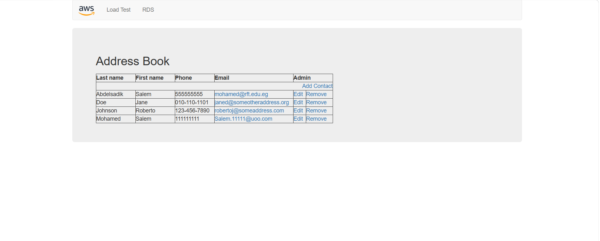
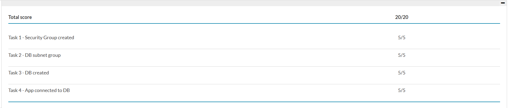
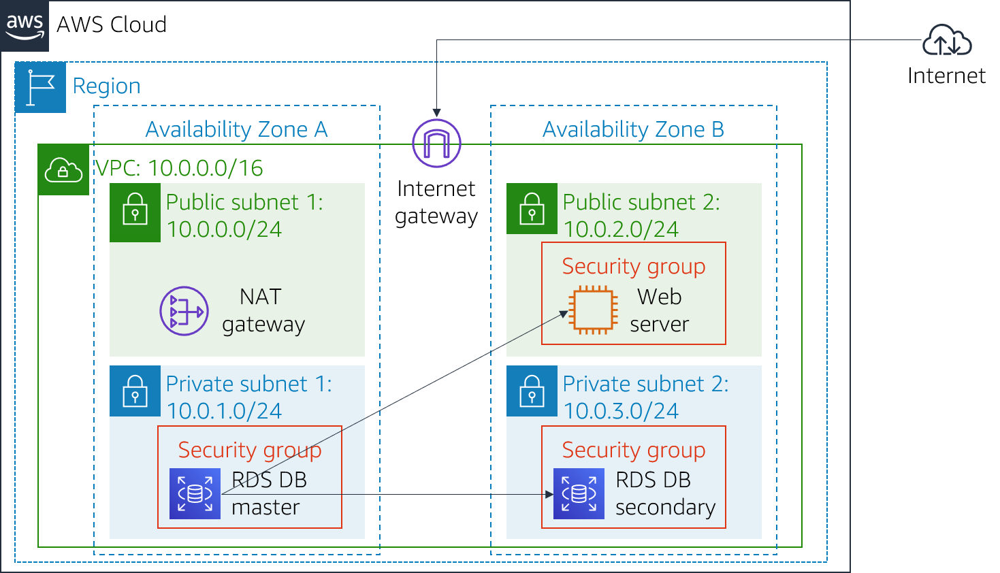

# AWS RDS Database Management

## Project Overview

This project demonstrates how to build and configure an Amazon RDS MySQL database and connect it to a web application running on an Amazon EC2 instance.

The main goal is to create a highly available database using Amazon RDS Multi-AZ deployment, configure secure communication between the web server and database, and interact with the database through a web application.

## AWS Services Used

- **Amazon RDS:** Managed relational database service.
- **Amazon EC2:** Hosts the web application.
- **Amazon VPC:** Provides network isolation.
- **Security Groups:** Control inbound network traffic.
- **DB Subnet Groups:** Define the subnets available to the RDS database.
- **Amazon MySQL:** Database engine.

## Lab Tasks

### Task 1: Create a Security Group for RDS

Created a security group named `DB Security Group` to allow the web server to connect to the RDS database.

**Configuration:**
- Security Group Name: `DB Security Group`
- Description: `Permit access from Web Security Group`
- VPC: `Lab VPC`
- Inbound Rule: MySQL/Aurora
- Port: `3306`
- Source: `Web Security Group`

### Task 2: Create a DB Subnet Group

Created a DB subnet group to specify which subnets Amazon RDS can use.

**Configuration:**
- Name: `DB-Subnet-Group`
- Description: `DB Subnet Group`
- VPC: `Lab VPC`
- Availability Zones:
  - `us-east-1a`
  - `us-east-1b`
- Subnet CIDR Blocks:
  - `10.0.1.0/24`
  - `10.0.3.0/24`

### Task 3: Create an Amazon RDS Database

Created a MySQL database using Amazon RDS with a Multi-AZ deployment.

**Configuration:**
- Engine: MySQL
- Template: Dev/Test
- DB Instance Identifier: `lab-db`
- Master Username: `main`
- DB Instance Class: `db.t3.micro`
- Storage Type: General Purpose SSD
- Allocated Storage: `20 GiB`
- Deployment: Multi-AZ DB Instance
- Initial Database Name: `lab`
- VPC: `Lab VPC`
- VPC Security Group: `DB Security Group`

### Task 4: Connect the Web Application to RDS

Connected the existing web application running on the EC2 instance to the newly created RDS MySQL database.

**Connection Configuration:**
- Endpoint: RDS Database Endpoint
- Database Name: `lab`
- Username: `main`
- Password: Lab-provided password

After submitting the connection details, the application successfully connected to the database and displayed the Address Book.

### Task 5: Test the Web Application

Tested the Address Book application by:
- Adding new contacts.
- Editing existing contacts.
- Removing contacts.

These operations verified that the application could interact with the RDS database and persist data.

## Screenshots

### 1. Security Group

Shows the security group configuration used to allow MySQL traffic from the web server.

### 2. DB Subnet Group

Shows the subnet configuration used by the RDS database across two Availability Zones.

### 3. Application Test

Shows the web application testing process.

### 4. Lab Result

Shows the final lab result after submitting the completed tasks.

### 5. Final Lab Architecture

Shows the final architecture of the AWS lab environment.

## Key Concepts Learned

- Creating and configuring Amazon RDS databases.
- Understanding Multi-AZ deployments and high availability.
- Configuring DB Subnet Groups.
- Managing Security Groups and inbound rules.
- Connecting an EC2 web server to an RDS MySQL database.
- Understanding database persistence and replication.
- Testing database operations through a web application.

## Conclusion

Successfully created and configured an Amazon RDS MySQL database with Multi-AZ deployment, established secure connectivity from an EC2 web server, and tested database operations through a web application.

This lab provided practical experience with AWS managed databases, networking, security, and high availability.

---

**Note:** This project was completed as part of an AWS educational lab. The database credentials were provided for the temporary lab environment and are not intended for production use.
